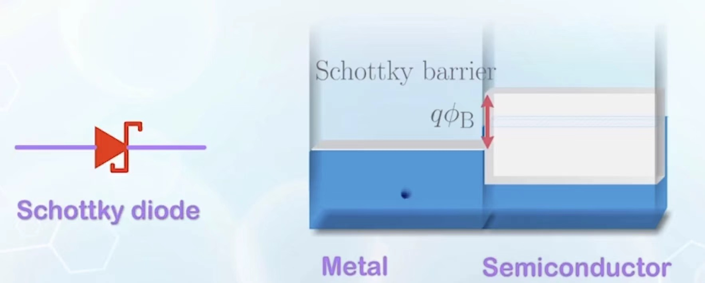

# 核心概念
Schottky Diode
## 材料的功函数
功函数定义为，从该材料的费米能级激发一个电子到自由状态所需要消耗的能量的势。

电子亲合能：将电子从自由状态固定到导带底部所释放的能量

利用功函数和电子亲合能，我们可以以自由电子能量为原点对金属和半导体的各个能级的能量进行比较，由此可以推导肖特基势垒：Schottky Barrier($\phi_{B}$):金属导带底部和和半导体导带底部的能量之差。

由图片可以看到Schottky diode
## 自建电场
仍然是首先计算出在还没有建立平衡之前费米能级之间的差值（使用功函数做差，其中半导体的功函数又可以拆分成电子亲合能加上禁带宽度减去（费米能级-本征费米能级），（费米能级-本征费米能级）可以通过套公式计算（建立与掺杂浓度的联系），这就是$V_{bi}$, 然后再通过建立泊松方程求解耗尽区长度。

## 电流状况
对于N型半导体而言，下面的空穴稀少，不用考虑金属的电子扩散导致的空穴迁移，所以只用计算导带的电子转移。

在热平衡时，高于金属旁接的耗尽区的能量的电子的扩散是任意的，所以此能量状态的电子两侧浓度一致。

但是当施加了外电压之后，（假如半导体侧接负压），那么那一侧的费米能级升高，那么半导体侧电子变多，电子从半导体侧往金属扩散形成电流，假设电子水平漂移速度为$v_{x}$,有一半的概率向两个方向中任意一个方向迁移，那么可以得到如下电流公式：
$$
I=(n_{S}-n_{M})\times \frac{1}{2} v_{x} q A
$$
而有$n_{S}=n_{M}e^{\frac{-V_{a}}{kT}}$, 并且热平衡时的$n_{M}$=现在的$n_{M}$,只需用$n_{M}=N_{C}e^{-\frac{E_{MC}-E_{F}}{kT}}$,我们就可以导出和PN结一样的MN结公式。

## 欧姆接触
### 线性欧姆接触
为了拟合电阻的线性性质，我们采用费米能级和N半导体的导带底部接近的金属作为接触材料，这样就能有类似于电阻的性质（减少了V_{bi}）。

### 管道接触
将半导体重掺杂，使得耗尽区宽度变窄，进而更容易发生隧穿的效应，能被击穿。

一般的PN结制作会在P端采用线性接触，N端采用管道接触，以达到导电的需求。

# 疑惑
为何肖特基接触时，在构建了自建电场之后，费米能级变成相同的了🤔