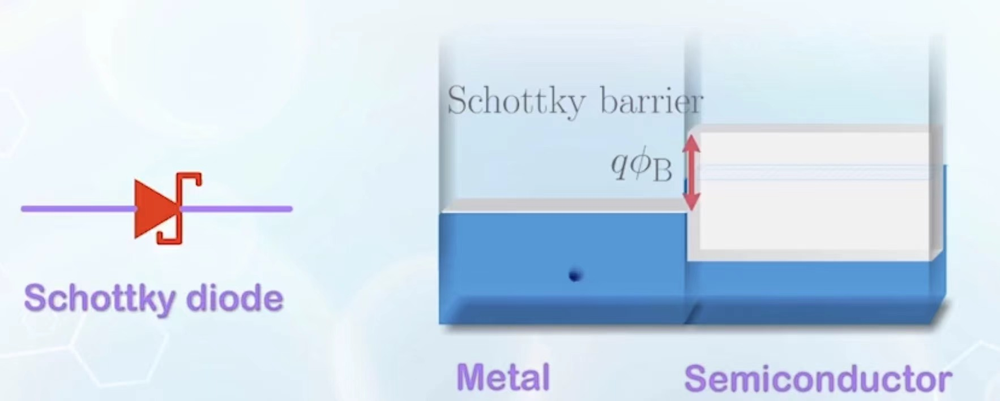

# 核心概念

Schottky Diode

## 材料的功函数

功函数 $W$ 定义为，从该材料的费米能级激发一个电子到自由状态所需要消耗的能量的势。

电子亲合能 $\chi$ ：将电子从自由状态固定到导带底部所释放的能量

对于金属，其导带和价带重合于费米能级，所以它的功函数和电子亲合能相等

对于没有建立热平衡的金属-半导体接触，我们发现电子从金属的费米能级运动到半导体的导带受到了一个势的阻挡，我们把这个势称为**Schottky Barrier($\phi_{SB}$)**:其值刚好就是两种材料的电子亲合能之差。

注意到电子亲合能之差只由材料本身决定，所以 Schottky Barrier 的大小不随其他条件变化。

## 热平衡的形成与自建电场、耗尽区

在建立热平衡时，以上图为例，半导体的费米能级高于金属，所以其在相同能量处的电子浓度更高，由于扩散作用，电子会从半导体运动到金属，形成耗尽区。然而与典型的PN结不同的是，金属的电子都分布在表面，所以耗尽区非常薄。在此之后由于电荷的积累，形成了自建电场平衡了费米能级导致的浓度差异

达到热平衡后，费米能级保持水平。那么自建电势就是对应的费米能级差值，即功函数差值（与肖特基势垒对应的亲合能差值形成对比）

计算 $V_{bi}$ ?

$$
V_{bi}=W_M-W_S=\chi_M-(\chi_S+\frac{1}{q}(E_c-E_F))=\chi_M-(\chi_S+\\[1em]\frac{1}{q}(\frac{E_G}{2}-(E_F-E_i)))=\chi_M-(\chi_S+\frac{1}{q}(\frac{E_G}{2}-kT\ln \frac{N_D}{n_i}))\\[1em]
$$

发现这个内建电势只和掺杂浓度相关。求出它之后，然后再通过建立泊松方程求解耗尽区长度，发现其实它就是 $N_A \to \infty$ 对应的PN结耗尽区长度。

## 电流状况

对于N型半导体而言，下面的空穴稀少，不用考虑金属的电子扩散导致的空穴迁移，所以只用计算导带的电子转移。

在热平衡时，高于金属旁接的耗尽区的能量（即高于 Schottky Barrier ）的电子的扩散是任意的，所以此能量状态的电子两侧浓度一致。

但是当施加了外电压之后，由于 Schottky Barrier 相对高度不发生变化，所以可以通过 Fermi-Dirac 分布计算金属在 SB(Schottky Barrier)之上的电子浓度是不发生变化的。那么我们可以以金属为基准计算半导体同能量处的电子浓度。

如果我们让半导体侧接负压即 forward bias，那么半导体一侧的费米能级升高，那么半导体侧电子变多，电子从半导体侧往金属扩散形成电流，假设电子水平漂移速度为 $v_{x}$ ,有一半的概率向两个方向中任意一个方向迁移，那么可以得到如下电流公式（ $A$ 为横截面积）：（在上述假设中我们忽略少子的运动因为其带来的电流微弱，我们称 Schottky Diode 为多子器件）

$$
I=(n_{S}-n_{M})\times \frac{1}{2} v_{x} q A
$$

而有 $n_{S}=n_{M}e^{\frac{qV_{a}}{kT}}$, 并且热平衡时的 $n_{M}$= 现在的 $n_{M}$ ,只需用 $n_{M}=N_{C}e^{\frac{-q\phi_{SB}}{kT}}$,我们就可以导出和PN结一样的MN结公式。区别仅仅在于前面的反偏电流常数项。

特别地，我们利用 $v_x\sim \sqrt{T},N_C \sim \sqrt{T^{3}}$, 可以得到电流关系式：

$$
I=KT^2 e^{\frac{-q\phi_{SB}}{kT}}(e^{\frac{qV_{a}}{kT}}-1)
$$

与PN结的对比：
1. 更容易击穿，因为耗尽区通常更短。
2. 不存在中性区边缘电容（靠的是热运动的机制而不完全是浓度梯度扩散）
3. 电阻更小
4. 更容易被打开，并且速度更快，因为 $V_{bi}$ 更小，而且不需要电子浓度梯度的构建

## 欧姆接触

本质上是去拟合电阻的伏安特性

### 线性欧姆接触

为了拟合电阻的线性性质，我们采用费米能级和N半导体的导带底部接近或者是费米能级和P型半导体的价带顶部接近的金属作为接触材料，这样就使得电子和空穴的流动几乎不会被阻挡（对应电子和空穴的势垒更低）能有类似于电阻的性质（减少了 $V_{bi}$ ）。

### 管道接触（使用击穿）

将半导体重掺杂，使得耗尽区宽度变窄，进而更容易发生隧穿的效应，能被击穿（Zener）。

一般的PN结制作会在P端采用线性接触，N端采用管道接触，以达到导电的需求。

# 疑惑

为何肖特基接触时，在构建了自建电场之后，费米能级变成相同的了🤔？

ans: 材料内部的电化学势应当保持一致，proven by 统计力学。

# 课堂扩展

1. 当金属的费米能级和半导体的费米能级持平时，右侧半导体的多数载流子不会被势垒限制，因此此时呈现的接触是**欧姆接触**，如果施加电压那么费米能级会呈现为一个缓慢下降连成一片的斜线。

2. 电子亲合能是一个**常数**，不随外界因素变化，只和材料主体种类有关。但是功函数和真空能量不是，但是真空能量随着位置的变化一定是连续的。

3. 材料的功函数的变化只由材料本身和其内部是否有电场决定（即有无电荷分布）

4. 二极管的**开启电压**有如下两种定义方式：

    1. 定义为半导体电流达到特定值的时候给它两端施加的电压。在这种定义下，看它的值的大小取决于二极管在线性区的工作情况。

    2. 定义为 $I-V$ 特性由指数变化改成直线变化的临界电压。确定这个电压主要看 $V_{bi}$