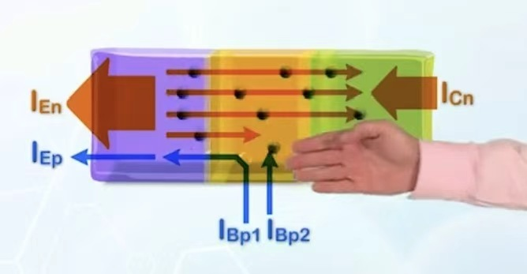
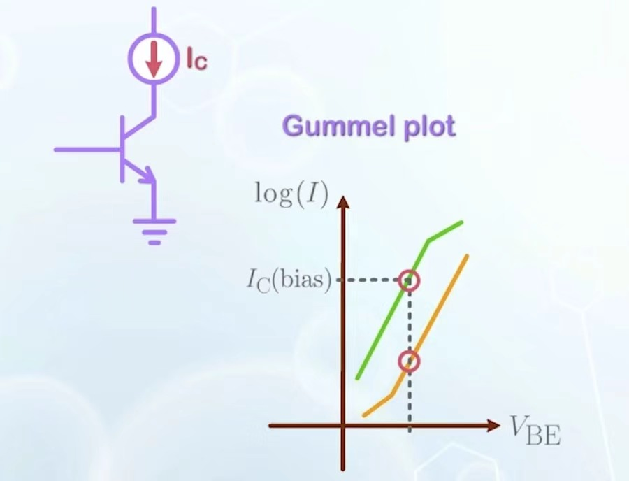

# BJT basics

## Formation of BJT

经典的BJT(Bipolar Junction Transistor),由N+,P,N构成（仅以此为例），相当于是两个PN结，其中中间的区域叫base, 高掺杂一端叫emmiter,低掺杂一端叫collector，我们使用base来控制电流的大小。

在BJT中，我们仍然关心其中的少数载流子，从N+端到N端依次浓度递增。

## Basic Principle

我们重点关心左边接forward bias，右边接reverse bias的情况。(forward active state)

在这种情况下，由于左边forward bias导致左侧耗尽区两侧的少子浓度增加，右边reverse bias导致两侧少子浓度减少，就可以绘制少子浓度的关系图。同时我们希望施加外电压后电子尽量少地从base流出，对此我们把BE偏压接在旁侧同时减小在基极的导电性能; 而BC采用反向偏置,来尽可能吸引处于基极的电子，以保证电流能尽可能多的流向集电极。

在BJT的forward active区中，电流的决定因素就是EB区的PN结以及在基极的复合情况，考虑到这两点之后，“我已神装”。

## Current Components

    

如图所示，BC的电流由电子电流和空穴电流构成，base中含有迁移的空穴电流，扩散的电子电流和漏电电流（流向base）（注意到途中基本没有电子向基极导线迁移的电流，是因为这个电流很小，我们在集电极施加了相当高的正电压把电子都吸引走了；我们也没有考虑反向偏压带来的空穴电流）

<!-- can be explored if timed permits! -->

我们定义了如下参数, $\gamma$ 衡量了发射极总电流中到集电极的电子电流的占比，$\alpha_T$ 衡量了上述电子电流有多少运动到了集电极。$\alpha$ 衡量的是总发射极电流有多少流到了集电极 ，而 $\beta$ 衡量了集电极电流和基极电流的比值。

$$
\gamma=\frac{I_{En}}{I_{En}+I_{Ep}}
\\[1em]
\alpha_T=\frac{I_{Cn}}{I_{En}}
\\[1em]
\alpha=\gamma\alpha_T=\frac{I_{Cn}}{I_{En}+I_{Ep}}
\\[1em]
\beta=\frac{I_{Cn}}{I_{Bp1}+I_{Bp2}}
$$

## Current voltage characteristics

我们根据肖特基方程以及比例常数 $\alpha$ 可以直接定量计算出集电极和基极的电流。注意到PN结的大注入效应和小结合电流效应任然存在。所以 $V_{BE}-\log I $ 图像会有如上弯曲,而 $\beta$ 就对应了高度差

对于我们常常使用的电路，为了保证输出对于输入的稳定性，我们不常使用稳定的 $V_{BE}$ 而是使用稳定的 $I_C$ ,因为可以发现 $\beta$ 和 $V_{BE}$ 变化对于电流更加平稳, 而如果固定电压，电压产生稍微小的波动电流就会指数波动。

而 $I_c$ 的大小仅仅由 $V_{BE}$ 决定, 和 $V_{BC},V_{CE}$ 无关。(ideal)

## Emitter and Base Design

我们代入PN结中的肖特基方程，利用对应种类载流子的电流的系数之比就能表示出 $\gamma$ （要使用到短二极管的扩散长度等于二极管长度）,为了让它更大，我们需要增加电流成分中电子电流的比例，对应于增加E区n掺杂,减少B区p掺杂。

然而，为了表示出 $\alpha_T$ ,我们要计算由于复合导致损失的电流 $I_{Bp2}$ ,为此我们引入在Base中平均存活时间的概念，我们设此为 $\tau$ 在该时间内B区所有的电子都因为复合而损失，那么如何求得电流？使用就是base中电子数目的积分（即面积）除以 $\tau$, 而我们的BJT很短，我们可以用计算三角形面积的方式来算，然后就可以计算 $\beta,\alpha_T$ (这里面的 $\tau$ 的计算方式和非平衡态一样)

通过公式可以发现，为了增加 $\alpha$, 我们一是要增加左侧N+区掺杂来提高比例差距，二是要缩短base宽度较少base电流。

