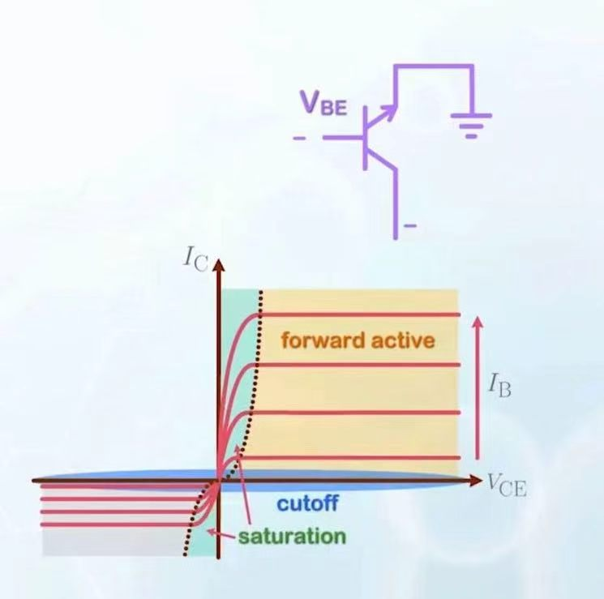

# 核心概念

## 几种不同的偏置方式

reverse active: 类似于forward active 只不过正向偏压施加在N-P区。此时由于掺杂的问题导致电流输运效果显著不如 forward active

cut off: 都反偏，导致几乎无电流

saturation mode: 都正偏，P区少子电流很弱，基本上都是空穴电流。

**求解电流：画出少子浓度图，然后计算由各个浓度梯度驱动的电流，叠加之后的电流就是不考虑复合得到的电流分布情况**

## IV trait in Saturation mode

    

在forward bias的情况中，集电极的电压大于基极的电压，当我们降低集电极的电压时，BC对应的PN结由反偏变成正偏，对应基极中的电子浓度随位置的变化曲线由陡峭逐渐变为平缓。

在这种改变的过程中，由于基极电子浓度曲线变得平缓了，对应电子扩散电流 $I_{Bn}$ 会变得比原来更小。而电子从两侧汇聚到中间使得对于复合的需求增加，基极的复合电流增大了。

此时的电流主要由空穴电流主导，其中流向发射极和集电极的电流大小由对应区域少子浓度梯度变化情况确定，基极为两部分相加再加上增大了的复合电流。

在正向偏置不太大时，我们任然可以忽略集电极空穴的电流，这时当正向偏置改变时，由于base区电子在耗尽区边缘的浓度变化的过渡是指数级的，所以在一开始的时候变化趋势很小，在后来才逐渐增加。饱和区的 $I_C$ 是随电压指数变化的。

**即通常认为：外加电压 $V_{BC}>0.5V$ 才进入饱和区**

>？？？图像为何可以到0
>
>Ans:我也觉得不能到0，因为此时随着BC区正向偏置的逐渐加大，越来越能削弱原有发射极输送的电流，当且仅当流向集电极的微弱总电流和反抗的空穴电流相平衡时，总电流为0。

## Early Effect

当我们让BJT在forward active的区域工作时，实际上中间区域的长度是随着反向偏压耗尽区长度变化而变化的，当耗尽区变宽时，对应base的有效长度减少，增加了 $I_C$ 这可以等效成一个电阻。

电阻的具体计算使用链式求导法则可以得到，由此得到的重要公式是

$$
\frac{dI_C}{dV_{CE}}=\frac{I_C}{V_{EA}}
$$

$V_{EA}$ 就是Early电压，一般来说相当大，所以我们一般可以直接用电流除Early电压得到电导。

削弱影响：只需要减小耗尽区长度在base总长度中的比例

1. 增加base的长度

2. 增加base的掺杂浓度，降低collecter的掺杂浓度

## Base Punch Through

当耗尽区长度延申到完全铺满P区时，中间的P区就无法完成其整流的作用。对应于BC偏压很大很大时电流的陡然上升。

## BJT breakdown

区分两个概念 $BV_{CEO}$ 与 $BV_{CBO}$ ，两种breakdown voltage, 第一种是 breakdown voltage for common-emitter with base open,
第二种的全名是 breakdown voltage for common-base with emitter open, 所谓 common，就是指把对应部分接地

第一种的大小比第二种显著更小，因为第二种breakdown本质上就是BC部分对应的二极管的breakdown。但是第一种在BC部分对应的二极管还没有发生breakdown时，在耗尽区激发出的空穴会被运输到emitter，输运完成之后削弱了原来的耗尽区电场，使得原有势垒减小，进而产生更多的（ $\beta$ 倍） 的电子导致breakdown，正反馈。

避免方式：
1. 减少 $\beta$ 
2. 减少collecter区域的掺杂，增加耗尽区宽度。