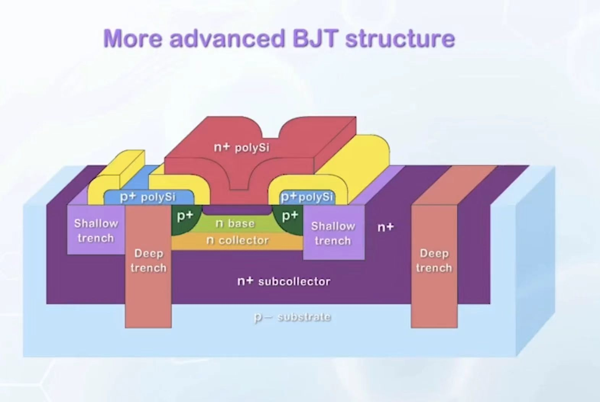

# 核心概念

## Ebers-Moll model 简化电路

在不考虑BJT的两个PN结的相互作用时，我们常常将其表示如下：

## Small Signal Model

在绘制正向放大区的小信号模型的时候，我们假如要考虑电容，那么电容包含BE结的两个PN结电容，BC之间的接触电容(耗尽区)，以及C端和体端接触的电容。

特别之处在于，原本我们使用 $C_{\pi}=\frac{Q_B}{V_T}$ 进行计算（扩散电容）。但是我们更希望把 $Q_B$ 写成关于 $I_C$ 的形式。同样使用三角形的面积计算电荷量

$$Q_B=\frac{1}{2}n_{B0}e^{\frac{qV_{BE}}{kT}}qW$$
$$I_C\approx \frac{qn_{B0}D_n}{W}e^{\frac{V_{BE}}{V_T}}$$
$$Q_B=I_C\frac{W^2}{2D_n},\tau_B=\frac{W^2}{2D_n},g_m=\frac{I_C}{V_T}$$
$$C_{\pi}=g_m\tau_B$$

## Frequency Response

由于电容的存在，当信号的频率没有那么高的时候，$\beta$ 表现为恒定的值，因为电容的等效阻抗很大。然而如果信号频率足够高，我们需要用复阻抗解出输出电流关于输入电流的表达式，当输入电流前面系数（即为 $\beta$ 为1时，就能解出对应的 $\omega$ (对应于 $f_T$ )

$$f_T=\frac{g_m}{g_m\tau_B+C_{\mu}+C_{jE}}$$

可以看到 $f_T$ 随着 $I_C$ 的增加，一开始的时候由于 $g_m$ 变大逐渐增加，然而到了一定的值之后反而还减小，这是因为大注入效应导致的 $\beta$ 衰减的比正常情况快。

## Advanced BJT

实际上我们设计先进BJT时有如下特点

1. 使用很大面积的n+掺杂多晶硅连接发射极，减少空穴扩散电流。

2. 基极两侧重掺杂减少电阻

3. 使用隔断介质避免寄生电容。

