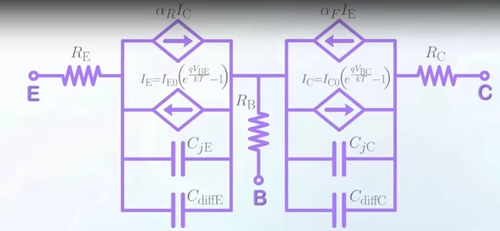
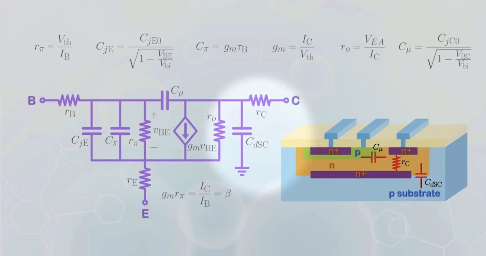
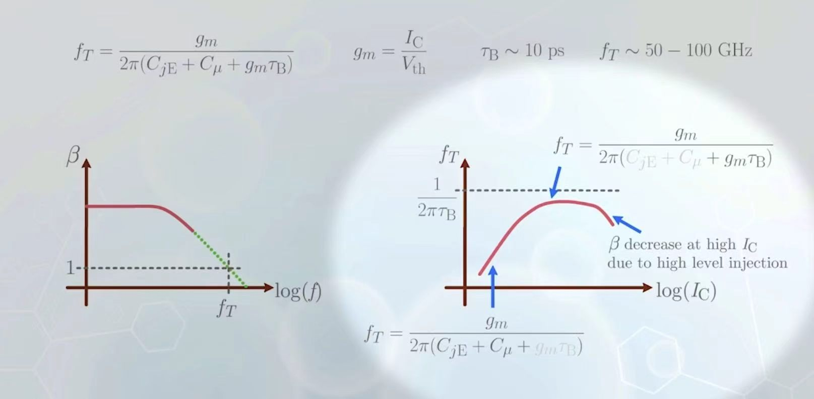

# 核心概念

## Ebers-Moll model 简化电路

在不考虑BJT的两个PN结的相互作用时，我们常常将其表示如下：

## Small Signal Model

表示如下：

## Frequency Response

当信号频率变化很大时，随着其增加 $\beta$ 会随着 $\log f$ 先保持不变然后线性减小，而对应的截止频率（即使得 $\beta=1$ 的频率）会随着 $\log f$ 增加先增大后减小。

