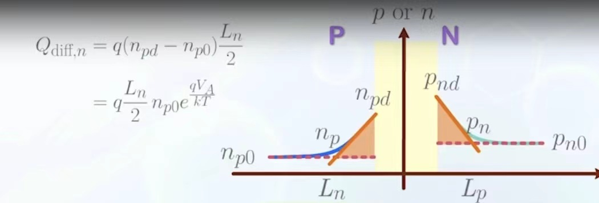

# 核心概念

## 耗尽区电容：the Voltage barrier capacity under Reverse Bias

利用电容计算公式$C=\frac{\epsilon_{Si}A}{d}$，我们已知耗尽区长度（前面的公式），把面积$A$归一化之后可以推知耗尽区的电容
$$
C_{d}=\frac{\epsilon_{Si}}{\sqrt{\frac{2\epsilon_{Si}(V_{bi}-V_{a})}{q}(\frac{1}{N_{A}}+\frac{1}{N_{D}})}}
$$
我们希望提取出与$V_{a}$无关的项，那么式子变为：
$$
C_{d}=\frac{C_{0}}{\sqrt{1-\frac{V_{a}}{V_{bi}}}}, \ which \ C_{0}= \frac{\epsilon_{Si}}{\sqrt{\frac{2\epsilon_{Si}V_{bi}}{q}(\frac{1}{N_{A}}+\frac{1}{N_{D}})}}
$$

## 中性区边缘电容: the diffusion capacity under Forward Bias

除了这个因素之外，中性区边缘也会有电荷积累（当正向偏压足够大时，多子会从自己的区域扩散到另一侧），这可以被表示为下图中的三角形面积

将图片里的电子电荷与空穴电荷相加我们就可以得到总电荷了，再通过求导计算电容
$$
C=\frac{dQ}{dV_A}
$$

## 实际情形

等效于：理想二极管（e指数变化）分别并联上两种电容，再和电阻串联。

可分为大范围信号和小范围信号考虑：

1. 在信号范围大时，使用实际公式
2. 在信号范围狭窄时，使用切线斜率对应电阻来等效替代二极管，其他元件直接取对应数值
    - 交流小信号导纳推导：
    $$
    g=\frac{dI}{dV_A} \approx \frac{qI}{kT}
    $$

## 参数提取

实际的二极管，人们会用实验测量二极管的特性，值得关注的有：

- 正向偏压足够大时退化为电阻的电阻大小
- 偏置参量 $n$，即把公式改为
    $$
    I=I_s(e^{\frac{qV_A}{nkT}}-1)
    $$
    $n$ 的取值一般是零到2
- 参数 $V_{on}\approx V_{bi}$

# 课堂补充

nullptr!!!