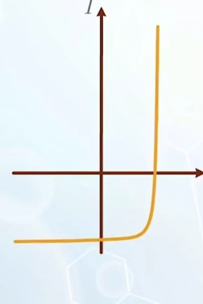

# 核心概念

## Iphoto

当有光线照进了耗尽区时，会产生反向电流，反向电流的大小正比于光照强度

如果给他施加偏压，那么对应电流就是

$$
I=I_0(e^{\frac{qV_a}{kT}}-1)-I_{photo}
$$

将图像向下平移

## 光探测器

结构：外加电源+diode+电阻，测量电阻电压。保证二极管处于反偏状态（正常的电流很小），那么电路中只剩下光电流。

## 太阳能电池

结构：diode+电阻，通过绘制出的I,V曲线和电阻的IV曲线可以得出对应的电流电压和功率。在绘制曲线时，取电压和电流为一致的参考方向，可以看出工作区域在第四象限。

由于约束在 $e$ 区工作，所以我们电流为0的电压要小于 $V_{bi}$ 。为了让电压更大，我们采用串联的结构。

材料：使用 $SiH_{4}$ 在透明介质表面形成多晶硅和杂乱分布的硅结构，与直接做单晶硅相比，有如下比较：
1. 成本低：只需要 $700K$ 的温度进行加工。
2. 透光性好
3. 由于晶格缺陷，其电子在能带运动时会分散，削弱了导电性能。

设计：
1. 为了让耗尽区接近表面同时光可以完全被耗尽区吸收，需要让它更厚，因此要采取轻度掺杂的p型硅做衬底接近表面时重掺杂，但是轻掺杂后会使得 $V_{bi}$（即可以提供的最大电压）下降，方法是在n和p型硅之间夹一个本征硅（能完全耗尽），这样可以让 $V_{bi}$ 大的同时宽度也大。
2. 表面防止光漏出的同时增加受光面积。

## 发光二极管

发光二极管的发光种类取决于电子和空穴复合时电子坠落发出的能量，即禁带宽度。越大，$f$ 越高。

电子与空穴复合发出能量，为了最大化能量效率，人们一般把耗尽区的 band 做成凹凸不平状，以使得电子在扩散长度之内就能完全跌入空穴。方法是，在原有耗尽区加入禁带宽度更小的材料。

同时为了避免光在介质里面的损失，我们使用相似折射率的材料覆盖表面。

# 课堂补充

1. 感光二极管的敏感程度的影响因素：
    
    1. 与反向偏置电流的大小的比值。
    2. 耗尽区长度。

2. 响应速度的影响因素:

    1. 结电容大小：越小越好 $\tau=RC_{depl}$ ,反向偏置时的二极管耗尽区长，电容小。

    2. 耗尽区内电场强度大小，电场强度越高，越能及时输运光生载流子。
