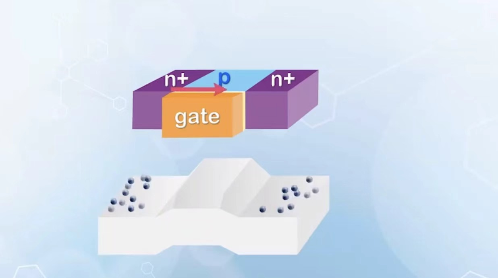
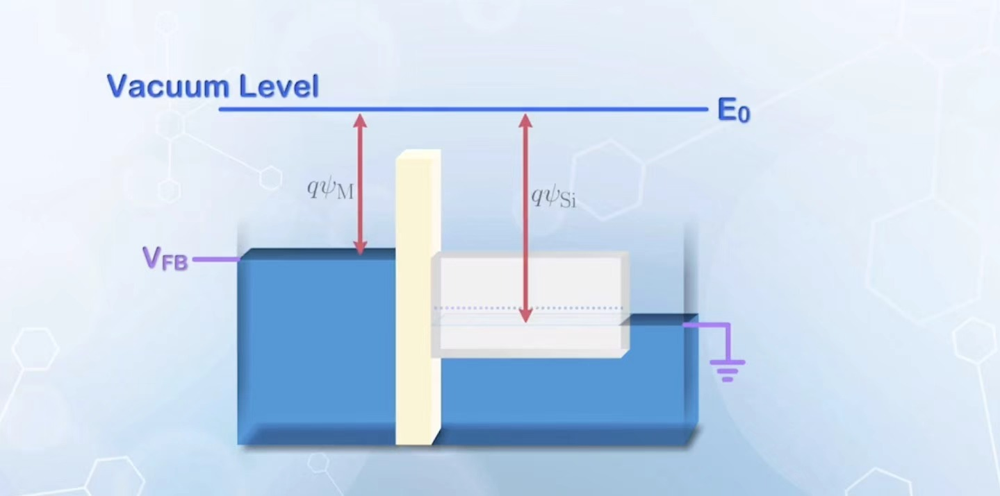
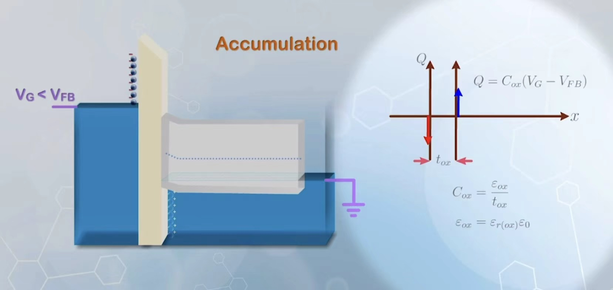
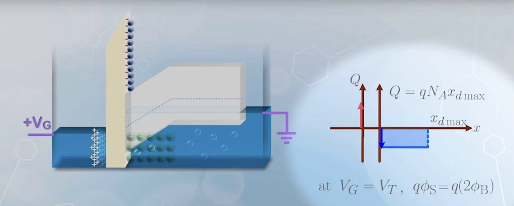

# 核心概念

## Structure of a MOSFET

MOSFET的结构无非是一个让BJT的base电压用电容来控制，然而这个电容电压对于下面介质的能带的改变不是均匀的，因为在费米能级水平的情况下会产生不同的电子空穴分布

MOS中的M是指Metal, 实际中我们常常使用重掺杂的n型多晶硅，此时它的表现近似于金属，所以用金属来分析之后的内容。

## Structure of a MOS compacitor

MOS电容上的压降包含了两个部分：在绝缘体上的压降和在P型硅上的压降。为了方便讨论，我们先确定出一个给金属的电压使得在接触之后能带水平。在能带水平的条件下，由于电子亲合能是定值，对应的真空能级也是水平的，又因为连续，所以可以作为一致的参考。

假如我们给金属施加了一个负电压，那么金属对应的真空能量（只需要看导带能量上升量，因为电子亲合能是定值）和费米能级能量上升量一样，所以功函数和没有施加电压时相同。因此，我们直接使用功函数之差得到需要的电压

$$
V_{FB}=q(-\psi_{Si}+\psi_{M})
$$

在这种情况下，由于导带平直，对应电场强度为0，那么没有电荷的积聚。

## Accumulation Mode

当我们施加的电压比 $V_{FB}$ 还要更负时，此时会吸引在氧化物右侧的空穴（因为是P型半导体）由于产生的电荷都会积聚在导体表面的区域，所以这时等效为一个平行板电容器。满足：

$$
Q=\frac{\varepsilon_{Si}}{d}(V_{FB}-V_G)
$$

## Depletion Mode

如果施加的电压负的凶不过 $V_{FB}$ ，在差异不大的范围内（即半导体左端的费米能级任然在能带的中心线之下），空穴任然是主导电荷的项。然而这时只能通过空穴的离开来产生负电荷，于是由于掺杂浓度有限，电荷密度最多就是 $N_A$ 。此时就不能通过平行板电容计算。

## Inverse Mode

如果施加的电压达到或者超过了一定值 $V_T$，这个值能恰好使得费米能级在能带中的相对位置和原来对称，使得影响 $Q$ 大小的主要因素除了耗尽模式的空穴移走还有导带电子的积累。这时表达式如下：

$$
Q=\frac{\varepsilon_{Si}}{d}(V_{G}-V_{T})+qx_dN_A
$$

其中 $x_d$ 为最大耗尽长度。