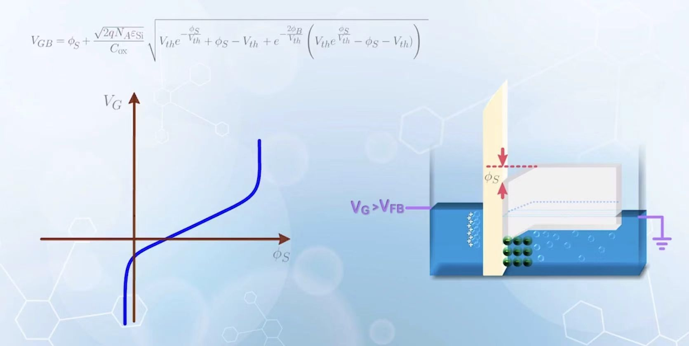
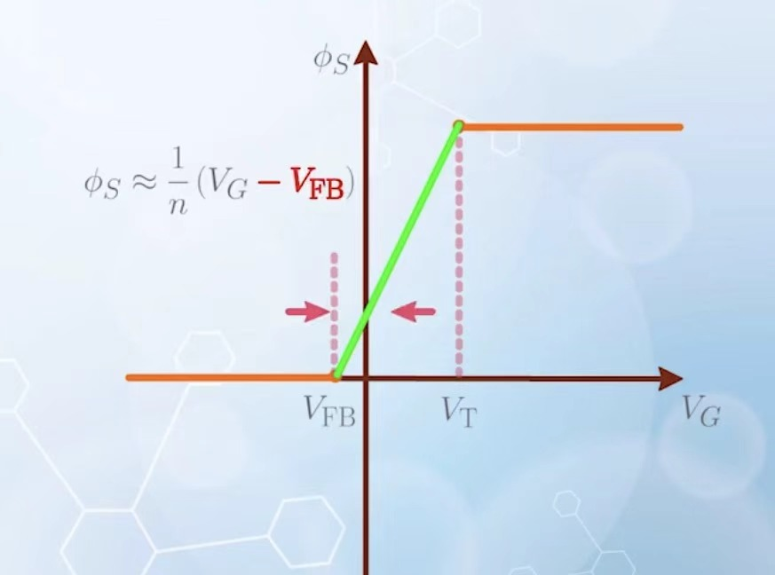
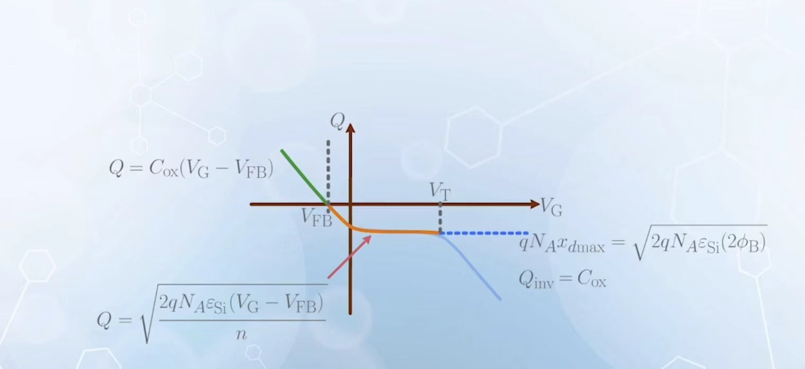
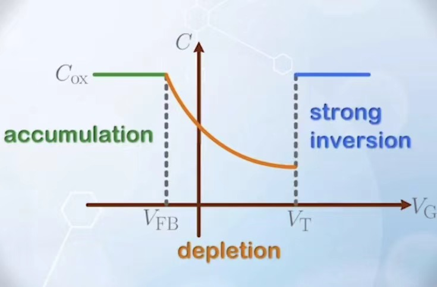
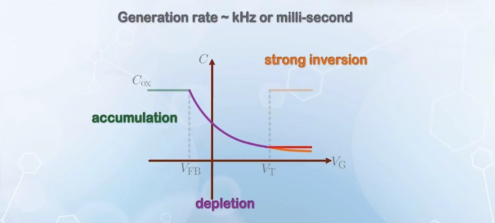

# 核心概念

## Accumulation and Depletion charge

计算积累方式下的电荷量，本质上就是和 $V_{FB}$ 之间的差异乘电容 $C_{0x}$

在耗尽模式下的电荷，如果已经知道导带高度的变化量 $q\phi_S$ ，那么对应耗尽区电势就是 $\phi_S$ ,我们直接利用静电场的性质就可以得到
$$
qN_A x_d=Q\\[1em]
\frac{qN_Ax_d^2}{2\varepsilon_{Si}}=\phi_S\to Q=\sqrt{2qN_A\varepsilon_{Si}\phi_S}
$$

## Calculate $\phi_S$

我们发现 $V_G$ 和 $\phi_S$ 之间存在如图关系，但是为了简化，我们认为 $\phi_S$ 随着 $V_G$ 按照过了平带电压 $V_{FB}$ 才开始线性增加，到了阈值电压 $V_T$ 之后反型不再增加。通常定义 $V_T$ 是使得 $\phi_S=2\phi_B$ ($\phi_B$ 是原费米能级和能带中央的差值) 的电压。

<table>
    <tr>
        <td></td>
        <td></td>
    </tr>
</table>

## Threshold voltage and inversion change

在阈值电压时，由于 $\phi_S=2\phi_B$ ($\phi_B$ 是原费米能级和能带中央的差值)，计算它的方式如下：

$$
V_T=\frac{\sqrt{2qN_A\varepsilon_{Si}2\phi_B}}{C_{0x}}+2\phi_B+V_{FB}
$$

其中电荷量随着施加栅电压的关系如上。

## Capacity

$$
C=\frac{dQ}{dV_G} 
$$
电容随着施加栅电压变化如下：

## Varied Measured Capacitance in Inversion Region

我们考虑测量反型区电容的不同方式：

1. 施加缓慢变大的直流信号，缓慢变化的交流信号：这时，我们测量的电容和电容图像一致，因为耗尽区的载流子产生和输运都能有充足的时间进行（不会被交流信号干扰），对于变化信号产生响应的是反型电子。

2. 施加缓慢变大的直流信号，快速变化的交流信号：这时反型电子可以形成但是不会随着交流信号改变发生响应（因为来不及），发生响应的是空穴对应于原有最大耗尽区电容。

3. 施加快速变大的直流信号，快速变化的交流信号，这时反型电子不会产生因为来不及输运，所以对应的耗尽区长度增加，电容值减小。