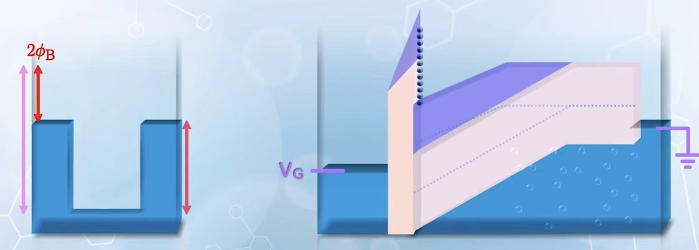
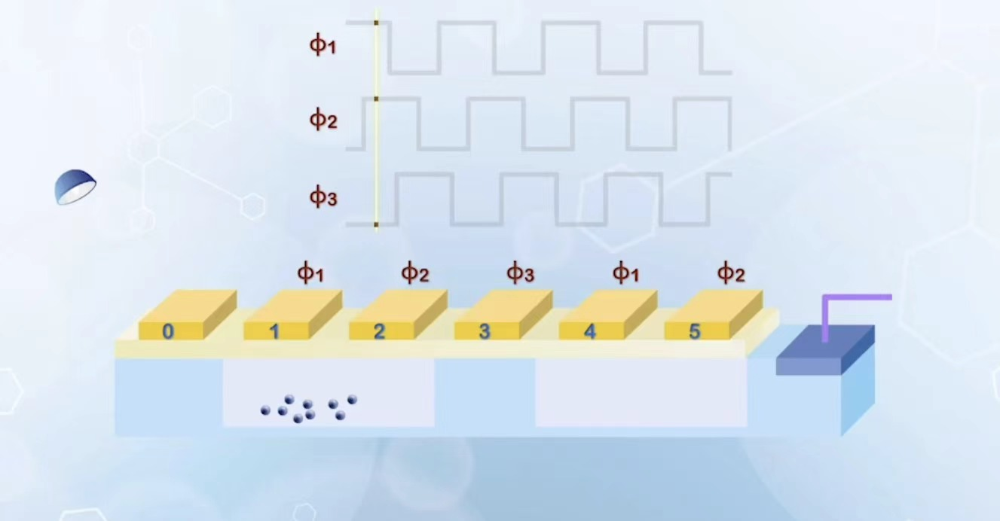
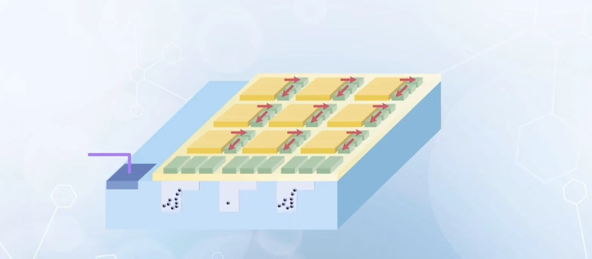

# 核心概念

## CCD operation Mode

如果给MOS电容施加快速变化的直流信号，那么它的耗尽区就会不断延长。当光照射到耗尽区时，就会产生光生电子。光生电子被耗尽区电场输运到半导体的导带，形成反型电子

为了保证正常工作，我们不希望MOS电容建立热平衡，也就是说光生电子的产生速率要远大于热平衡反型电子的补偿速率。如果要测量光强也就是光生电子的数量，需要尽快将产生的电子输运到测量仪器中

通过光激发可以填充的电子数量取决于quantum well的深度。所谓quantum well即是我们施加的电压导致的 $\phi_S$ 与实际最大表面电压 $2\phi_B$ 之间的差异，电子可以填充的部分就是紫色的区域。

## CCD image sensor Architecture

<table>
    <tr>
        <td></td>
        <td></td>
    </tr>
</table>

如图，由零号位置感光，其他的MOS都是在某一个特定的时刻电压突然跳变到高电压（保证耗尽区可以延申），由此依次产生quantum well接纳电子。

## CCD design and structural optimization

在实际的CCD设计中，首先为了为了防止被击穿，氧化物层的厚度会做的比较大，而能让电压尽可能施加到p型半导体的耗尽区，希望降低半导体部分的电容，这可以通过轻掺杂实现（而且耗尽区还更长）。

## Practical performance

ghost Images:。光驱动的电子产生太多，占满了quantum well导致溢出，当光消失时，这些溢出的电子回到了原有well显得图像有留存

Aliasing: 光驱动的电子产生太多，占满了quantum well导致溢出，这些溢出的电子跑到了别的well，导致没光的地方看来也有了光。

## CMOS APS

直接将每个MOS电容的光电子信息用放大器放大之后输入到处理器

