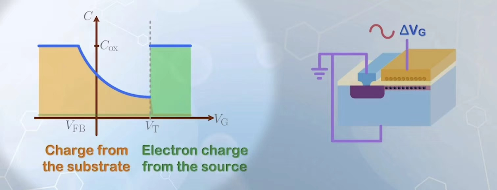
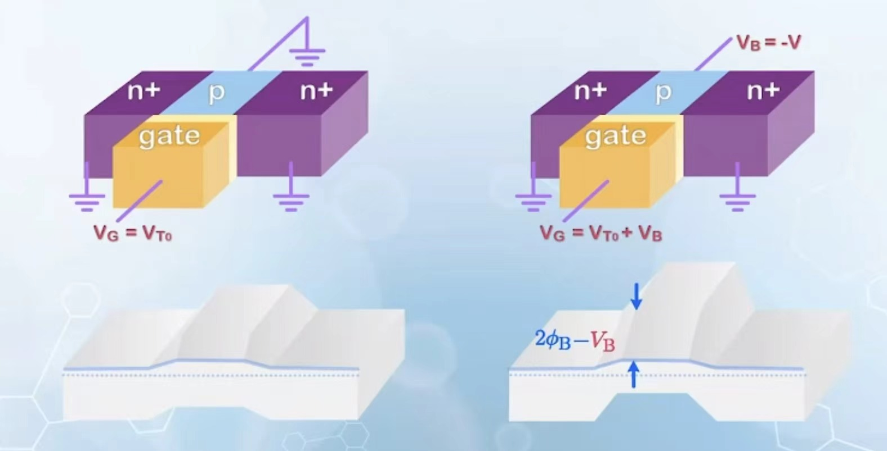
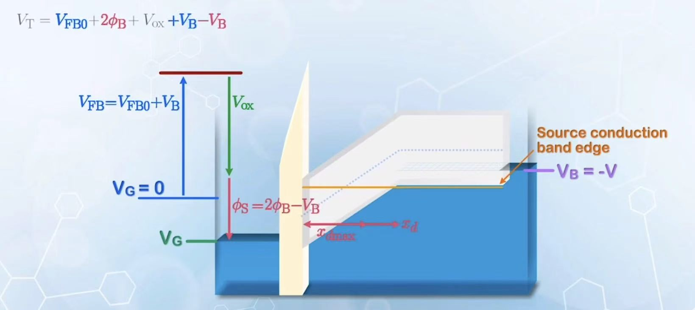
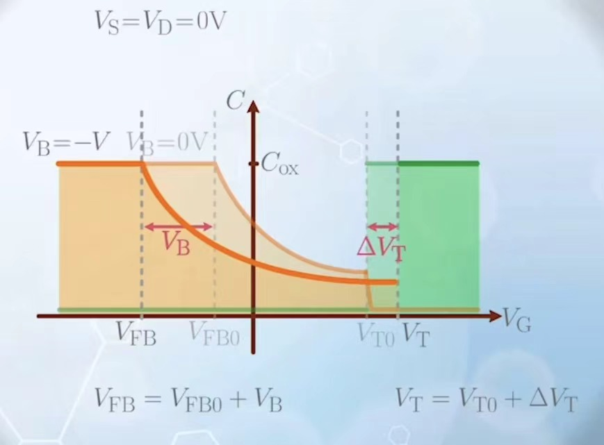
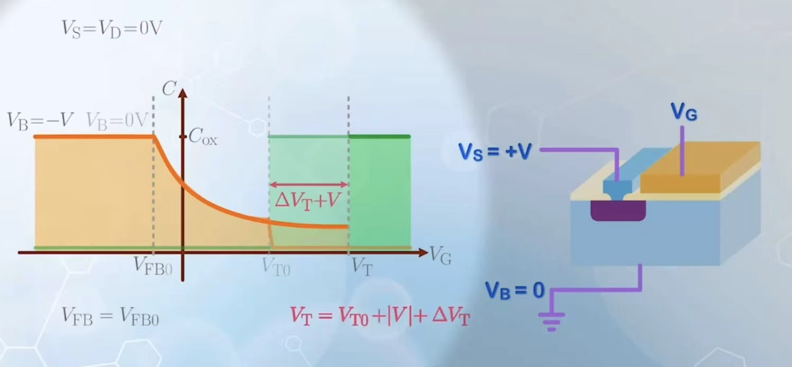

# 核心概念

## CMOS

## MOS capacitor with a source

当我们给MOS电容的左边增加了一个接地的源极时，其电容变化情况可以这样描述：当 $V_G$ 比较小时（小于 $V_{FB}$），电容就是氧化物电容。逐渐增大后电容被半导体区域的耗尽区影响，下降。到了 $\phi_S>2\phi_B$ （ $V_G>V_T$ )之后反型区可以被源极提供的电子占据。因此电容就是氧化物电容

## Effect of Body Voltage

如果我们对体端施加负电压 $V_B=-V$ ，从banddiagram的角度说，体端被抬高。如果想让MOS电容半导体侧能带水平，那么 $V_G=V_{BF0}+V_B$ 其中 $V_{BF0}$ 为原有的flat band电压。

>*本质上所有MOS电容相关的要满足和0偏压相同的物理状态对应的 $V_G$ 都要加 $V_B$*

现在我们声明 $\phi_S=2\phi_B$ 的含义是使得电子能从源极和漏极自由跨越体端的表面电势。但是在当前情况下，体端被抬升了 $V_B$ ，所以我们需要的 $V_G$ 要使得 $\phi_S=2\phi_B-V_B$

注意到此时 $\phi_S>2\phi_B$ 但是耗尽区长度理论上又不应该超过 $2\phi_B$ 对应的 $x_{dmax}$ 。耗尽区长度可以超过阈值的原因是：反型区电子所在的位置比源极和漏极更高导致它们都run了，只有增加耗尽区长度才能补偿电压的升高。

## Threshold voltage with a substrate bias

求解现在的 $V_T$ 其实不困难，我们从满足当前的平带条件为基准，施加电压 $V_G$ 的增加量等于氧化物两端的电压加上半导体耗尽区导致的电压。

$$V_T=(V_{BF0}+V_B)+\frac{Q_{depletionsum}}{C_{0x}}+2\phi_B-V_B$$

又利用耗尽区电荷量和电势的关系：

$$Q_{depletionsum}=\sqrt{2q\varepsilon_{Si}N_A(2\phi_B-V_B)}$$

thus

$$V_T=V_{BF0}+2\phi_B+\frac{\sqrt{2q\varepsilon_{Si}N_A(2\phi_B-V_B)}}{C_{0x}}$$

原来的 $V_T$ 是

$$V_{T0}=V_{BF0}+2\phi_B+\frac{\sqrt{2q\varepsilon_{Si}N_A2\phi_B}}{C_{0x}}$$

做差得到

$$V_T=V_{T0}+\frac{\sqrt{2q\varepsilon_{Si}N_A}}{C_{0x}}(\sqrt{2\phi_B-V_B}-\sqrt{2\phi_B}), \gamma=\frac{\sqrt{2q\varepsilon_{Si}N_A}}{C_{0x}}$$

意思是源极/漏极电压比体端如果更高 $V_{SB}>0$ ，其对应的 $V_T$ 也会更高。

## MOS capacitor with body-biased

体端有负偏压的 MOS ，其平带电压较原来更小，而其 $V_T$ 却高了考虑体效应的部分，特别地，中间部分的电荷-电压关系和以前相同都依靠耗尽区长度延申来维持。所以曲线如下

<table><tr>
<td></td>
<td></td>
</tr></table>

特别地，如果我们给除了 $V_G$ 之外的部分都接上一个大小为 $V$ 的正电压，那么曲线只需要向右平移 $V$ (思考 $V_{BF}$ )

通常我们会忽略体效应。
