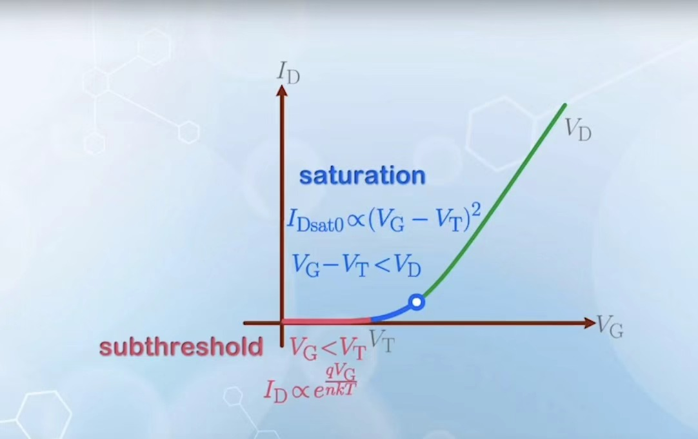
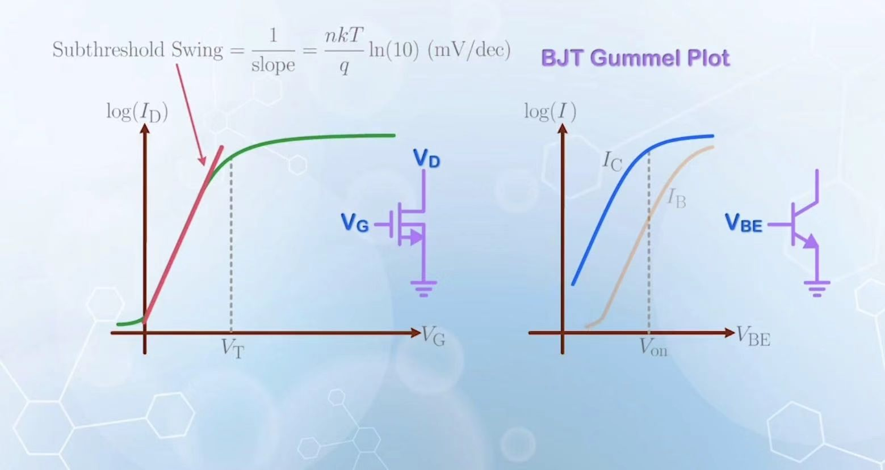
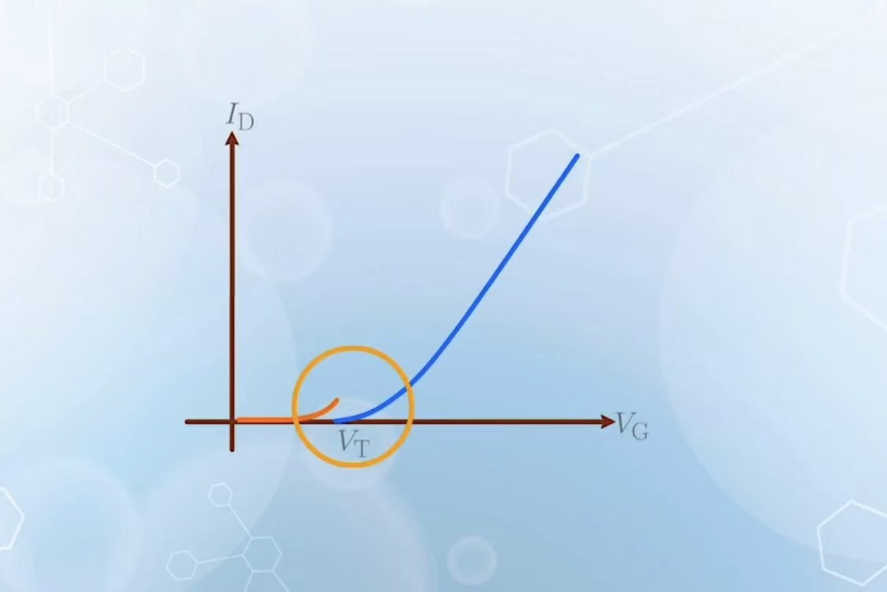
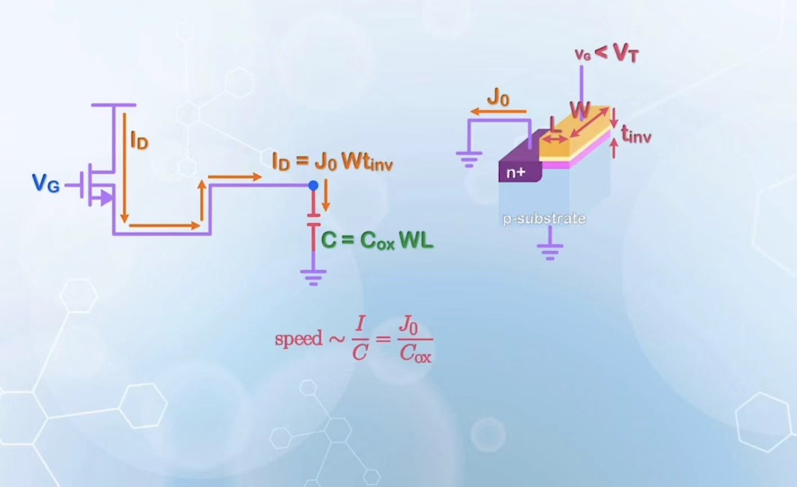
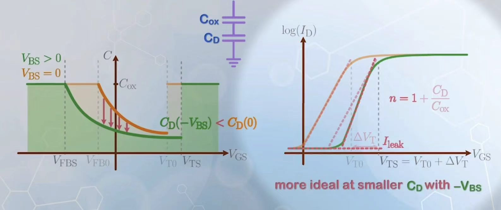

# 核心概念

## MOSFET threshold region

当施加电压小于阈值电压 $V_T$ 时，事实上就和BJT一样，流过势垒的电流和表面电势差有着指数倍的关系

$$I=I_{D0}e^{\frac{q\phi_S}{kT}}$$

而事实上 $\phi_S=\frac{V_G-V_{FB}}{n}$

那么归并了常数之后，就发现 $I=I_{D0} e^{\frac{qV_G}{nkT}}$，这就是亚阈值效应。

## Turn on charateristic

<table>
    <tr>
        <td></td>
        <td></td>
    </tr>
</table>

亚阈值效应的重要之处在于：决定了MOSFET漏电现象发生时漏电电流和正常电流的比例。

当我们给定 $V_D$ 电流随电压的变化关系如图所示（线性区和饱和区的分界点在 $V_D+V_{T0}$  而取了对数坐标之后如右图。

## Subthreshold Swing

在亚阈值区，我们希望相同的电压差异能让电流衰减的更快。Swing的值衡量当电流衰减为原来的十分之一时电压的减少量，所以要尽量减少Swing. 对应于减小 $n$ 。利用关系式 $n=1+\frac{C_D}{C_{ox}}$ 我们通常会减小氧化层的厚度。

## Current at Threshold Voltage

注意到如果使用亚阈值效应得到的公式和饱和区电流得到的公式在 $V_G=V_T$ 点是不连续的。这是因为在计算饱和区电流时认为电容在 $V_T$ 点发生了突变（进入反型区之后电子才会主导电荷的积累），而实际上电子的主导是一个渐变的过程，电容并非连续。

## Loading speed

所有元件要达到工作状态都需要使得其电容被充满，这一个暂态过程的速度可以被公式

$$t=\frac{CV}{I} given \ V \ \to v=t^{-1}=\frac{I}{C}$$

描述

对于竖直方向制造的BJT而言，其电流和电容可以表示如下

$$I=J_0WL; C=C_{\pi}WL$$

所以其速度与宽度无关。

但是对于MOSFET,由于电流是在横截面内流动的，所以

$$speed\approx \frac{J_0 t_{inv}}{C_{ox}L}$$

因此可以通过减小 $L$ 来达到增大速度的效果。在图片中对应的含义是:右侧的MOS是loading，通过减少Loading的长度 $L$ 能达到加速的效果。

## I-V character with substrate Bias

如果给体端施加了负偏压，那么电容和电流的变化如图所示。电容总体相较原本没有施加负偏压下降，原因是 $C_D$ 在施加了负压之后对相同的 $V_G$ 延申的耗尽区更长了,使得串联的总电容变小。

## The current with body effect considered

考虑体效应时，需要用 $Q=C_{ox}W(V_G-V_{T0}-\gamma(\sqrt{2\phi_B+V_X-V_B}-\sqrt{2\phi_B})-V_X)$ 进行积分计算。理论上可以计算，但是考虑到式子的物理意义不是很好，我们使用Taylor 公式把上面的根号展开成线性的表达式，那么我们就只有了一个线性项的修正

$$I_D=\frac{1}{2}\mu C_{ox}\frac{W}{L}(2(V_{GS}-V_{T0})V_{DS}-\alpha V_{DS}^2)$$

对应饱和区公式要使用 $\frac{\partial I}{\partial V_{DS}}=0$ 得到边界 $V_{DS}$ 所以可以写成如下表达式。

$$I_D=\frac{1}{2}\mu C_{ox}\frac{W}{\alpha L}(V_{GS}-V_{T0})^2$$
